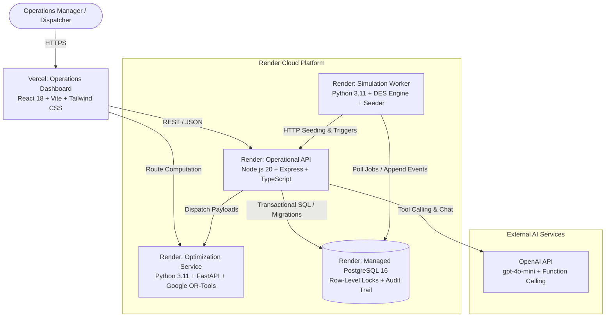

# DarkOps AI — Autonomous Quick-Commerce Operations & Optimization Platform

<p align="center">
  <a href="https://dark-ops-ai.vercel.app/">
    
  </a>
  
  
  
  
  
</p>

---

## 🌐 Live Production Deployments

| Component | Cloud Platform | Live Endpoint / URL | Health & Readiness |
|---|---|---|:---:|
| **Operations Dashboard** | **Vercel** | **[https://dark-ops-ai.vercel.app](https://dark-ops-ai.vercel.app/)** | Edge CDN Active |
| **Operational API** | **Render** | `https://darkops-operational-api.onrender.com` | [`/healthz`](https://darkops-operational-api.onrender.com/healthz) & [`/readyz`](https://darkops-operational-api.onrender.com/readyz) |
| **Optimization Service** | **Render** | `https://darkops-optimization-service.onrender.com` | [`/healthz`](https://darkops-optimization-service.onrender.com/healthz) & [`/readyz`](https://darkops-optimization-service.onrender.com/readyz) |
| **Simulation Worker** | **Render** | Background Worker (Continuous DES Engine) | Heartbeat Monitored |
| **PostgreSQL Database** | **Render** | Managed PostgreSQL 16 (SSL Enforced) | Migrations Applied |

---

## 1. Executive Summary

**DarkOps AI** is an industrial-grade decision-support, simulation, and mathematical optimization platform built for quick-commerce dark store operations (10-to-15 minute delivery). 

Quick-commerce fulfillment centers face severe operating bottlenecks: stockouts on high-velocity items, excess expiry waste, order allocation congestion across overlapping zones, and picker fatigue from inefficient warehouse traversal. 

DarkOps AI resolves these challenges through a unified, modular architecture combining:
1. **Authoritative Operational State**: Concurrency-safe inventory reservations (`SELECT FOR UPDATE`), multi-stage order lifecycles, and immutable audit ledgers.
2. **Operations Research Optimization**: Google OR-Tools solvers for Mixed-Integer Linear Programming (MILP) replenishment, balanced multi-store order allocation, and 2D warehouse picker route TSP sequencing.
3. **Discrete-Event Simulation (DES) Engine**: Virtual-clock scenario lab executing reproducible A/B policy evaluations against synthetic demand surges.
4. **AI Operations Copilot**: OpenAI `gpt-4o-mini` conversational copilot with typed function calling, two-stage human approval gating, post-execution verification, and PostgreSQL audit logging (strictly compliant with **ADR-009**).

---

## 2. System Architecture & Service Boundaries

DarkOps AI adheres strictly to domain-driven boundaries and separation of concerns. The platform consists of four distinct deployable units:



### Module Responsibilities & Boundary Invariants

- **Operations Dashboard (`apps/dashboard`)**: Pure presentation layer. Renders backend-verified data; never synthesizes authoritative metrics or inventory balances on the client.
- **Operational API (`services/operational-api`)**: Sole owner of transactional business invariants. Enforces strict state machines, atomic stock reservations, and idempotent mutations. External services never write directly to operational tables.
- **Optimization Service (`services/optimization-service`)**: Pure, stateless decision microservice. Accepts structured problem payloads, validates constraints, computes optimal decisions via Google OR-Tools, and returns explicit feasibility proofs.
- **Simulation Worker (`services/simulation-worker`)**: Isolated virtual operating world (`run_id`). Drives virtual time via priority-queue event scheduling, synthetic Poisson demand generation, and KPI calculations from recorded events.
- **AI Operations Copilot**: Decision-support interface. Read-only queries execute directly; mutating operations trigger a mandatory **Two-Stage Human-in-the-Loop Approval Gate**.

---

## 3. Core Capabilities & Technical Highlights

### ⚡ 1. Concurrency-Safe Inventory Reservations
- **Zero Overselling**: Implements pessimistic row-level locking (`SELECT FOR UPDATE`) across physical stock, reserved quantities, and available balances.
- **Battle-Tested Under Load**: Verified under high-concurrency race condition testing (50 simultaneous orders competing for 10 units yields exactly 10 reserved units and 40 deterministic out-of-stock rejections).

### 📐 2. Operations Research Optimization (Google OR-Tools)
- **Multi-Store Order Allocation**: Solves a multi-objective constraint program balancing customer proximity, stock availability, store queue depths, and carrier SLA deadlines.
- **Dynamic Replenishment Engine**: Computes economic order quantities (EOQ), reorder points (ROP), and supplier lead-time buffers while minimizing holding vs. stockout penalty costs.
- **Picker Route Optimization**: Models dark store layouts (aisles, racks, shelves) as a 2D graph. Solves Traveling Salesperson Problems (TSP) with A* obstacle avoidance to minimize picker travel distance by 25–40%.

### 🧪 3. Discrete-Event Simulation Lab & Surge Arena
- **Virtual Clock**: Advances time dynamically between discrete business milestones (order arrivals, wave batching, picking completion, dispatch, delivery).
- **Interactive Surge Stress Arena**: Inject instantaneous 300% demand spikes, localized supplier delivery delays, or store outages to stress-test network resilience.
- **Fair Policy Comparison**: Identical random seeds and scenario initializations feed both baseline and optimized policies to generate rigorous, side-by-side performance benchmarks.

### 📊 4. 100% Event-Derived KPIs (Zero Fabricated Metrics)
- DarkOps AI strictly rejects synthetic dashboard metrics. All metrics—including **Order Fulfillment Rate**, **Stockout Frequency**, **Mean Pick Time**, **On-Time SLA Delivery**, and **Inventory Turnover**—are mathematically calculated from recorded simulation events.

### 🤖 5. Production AI Copilot with Two-Stage Human Approval (ADR-009)
- **Natural Language Operations**: Operators can query network inventory, diagnose stalled orders, evaluate surge congestion, and formulate emergency restocks in plain English.
- **Human-in-the-Loop Gating**: The copilot CANNOT autonomously execute mutations. It issues an `ActionProposal` with impact analysis (`PENDING_APPROVAL`). The operator must review and explicitly click **Approve** or **Reject** in the UI.
- **Post-Execution State Verification**: Upon operator approval, the backend executes the mutation in a transaction, verifies updated balances in PostgreSQL, and records an immutable audit log.

---

## 4. Technology Stack

| Layer | Technologies | Rationale |
|---|---|---|
| **Frontend Dashboard** | React 18, TypeScript, Vite, Tailwind CSS, Lucide Icons | Sub-second reactivity, accessible components, and responsive quick-commerce operations control center. |
| **Geospatial & Warehouse Views** | Leaflet, React Leaflet, HTML5 Canvas 2D Graph | Interactive dark store cluster maps and visual warehouse aisle routing animations. |
| **Operational Backend** | Node.js 20, TypeScript, Express, Zod, pg | High-throughput async I/O, strict schema validation, and atomic PostgreSQL transaction handling. |
| **Optimization Microservice** | Python 3.11, FastAPI, Google OR-Tools, Pydantic | High-performance linear programming, constraint programming (CP-SAT), and graph solvers. |
| **Simulation Worker** | Python 3.11, SimPy concepts, NumPy, psycopg2 | Deterministic discrete-event simulation with virtual clock management. |
| **Database** | PostgreSQL 16 (Render Managed) | Relational integrity, row-level concurrency locking, JSONB spatial boundaries, and audit logging. |
| **AI Integration** | OpenAI `gpt-4o-mini`, Structured JSON Schemas | Fast, cost-efficient, typed function calling with strict parameter validation. |
| **Cloud Deployment** | Vercel (Frontend SPA) + Render (Backend Blueprint) | Automated CI/CD, SSL encryption, zero-config CDN caching, and managed PostgreSQL. |

---

## 5. Repository Structure

```text
DarkOps_AI/
├── apps/
│   └── dashboard/                 # React 18 + Vite Operations Dashboard
│       ├── src/
│       │   ├── components/        # Reusable UI, Layout, Visualizers, Copilot Drawer
│       │   ├── features/          # Overview, Inventory, Replenishment, Orders, Simulations
│       │   ├── lib/               # Typed API client, query cache, formatting helpers
│       │   └── test/              # Vitest component & integration test suites
│       ├── vercel.json            # Vercel SPA routing rewrites configuration
│       └── Dockerfile             # Multi-stage production container
├── services/
│   ├── operational-api/           # Express + TypeScript Operational API
│   │   ├── src/
│   │   │   ├── copilot/           # OpenAI copilot service & typed tool handlers
│   │   │   ├── database/          # Migrations (001-006), pool, SSL configuration
│   │   │   ├── domain/            # Catalog, inventory, order schemas & state machines
│   │   │   └── services/          # Concurrency-safe business logic services
│   │   └── tests/                 # Unit, contract, integration, and race condition tests
│   ├── optimization-service/      # Python + FastAPI + Google OR-Tools Engine
│   │   ├── src/
│   │   │   ├── models/            # Pydantic problem & decision schemas
│   │   │   ├── routers/           # Replenishment, allocation, and picker route endpoints
│   │   │   └── solvers/           # OR-Tools MILP, CP-SAT, and TSP graph solvers
│   │   └── tests/                 # Optimization solver benchmark tests
│   └── simulation-worker/         # Python Discrete-Event Simulation (DES) Worker
│       ├── scenarios/             # Default Manhattan 5-store network scenarios
│       ├── src/                   # Seeder, virtual clock, demand generator, evaluator
│       └── tests/                 # Determinism, job isolation, and formula tests
├── docs/                          # Architecture specs, OpenAPI schemas, ADR-001 through ADR-010
├── scripts/                       # Seeding and verification automation
│   ├── seed-demo.ps1              # One-click demo seeder (PowerShell)
│   ├── seed-demo.sh               # One-click demo seeder (Bash)
│   └── seed_realistic_orders.js   # Realistic order flow generator
├── docker-compose.yml             # Local multi-container development orchestration
├── render.yaml                    # Render Blueprint Infrastructure-as-Code specification
└── vercel.json                    # Root Vercel mono-repo fallback configuration
```

---

## 6. Automated Testing & Verification Suite

DarkOps AI enforces strict automated testing across all services before every deployment. **All 212 tests pass with 100% success**:

```bash
# Total Automated Test Coverage: 212 / 212 Tests Passing
├── Operational API (Node.js/Vitest):       107 passed (Unit, Contract, Concurrency Race)
├── Operations Dashboard (React/Vitest):     44 passed (Components, Views, Copilot Drawer)
├── Optimization Service (Python/Pytest):    18 passed (Solvers, Constraints, Benchmarks)
└── Simulation Worker (Python/Pytest):       43 passed (DES Engine, Seed Determinism, KPIs)
```

To run test suites locally:
```bash
# Run Operational API test suite
npm --prefix services/operational-api run test:unit

# Run Dashboard test suite
npm --prefix apps/dashboard run test

# Run Optimization Service benchmarks
python -m pytest services/optimization-service/tests

# Run Simulation Worker determinism tests
python -m pytest services/simulation-worker/tests
```

---

## 7. Quickstart & Local Development

### Prerequisites
- [Docker Desktop](https://www.docker.com/products/docker-desktop/) (v24+)
- [Node.js](https://nodejs.org/) (v20 LTS)
- [Python](https://www.python.org/) (v3.11)

### 1. Clone & Configure Environment
```bash
git clone https://github.com/harshchoudhary2103j/DarkOps_AI.git
cd DarkOps_AI

# Create your local environment file
cp .env.example .env
```
*(Add your `OPENAI_API_KEY` in `.env` to enable AI Operations Copilot capabilities).*

### 2. Launch Local Multi-Container Stack
```bash
# Starts PostgreSQL, Operational API, Optimization Service, Simulation Worker, and Dashboard
docker compose up -d --build
```

### 3. One-Click Automated Demo Seeding
Populate your local environment with 5 Manhattan dark stores, catalog SKUs, realistic stock positions, and customer orders:

```bash
# Windows PowerShell:
.\scripts\seed-demo.ps1

# Linux / macOS:
./scripts/seed-demo.sh
```

### 4. Open Control Center
- **Dashboard UI**: `http://localhost:5173`
- **Operational API**: `http://localhost:3000` (Health: `http://localhost:3000/healthz`)
- **Optimization Service**: `http://localhost:8000` (Swagger: `http://localhost:8000/docs`)

---

## 8. Production Deployment Guide

### Deploying Backend to Render
1. Connect your repository to [Render](https://render.com).
2. Create a new **Blueprint** and select `render.yaml`.
3. Provide your `OPENAI_API_KEY`. Render automatically provisions:
   - `darkops-postgres` (Postgres 16 with SSL)
   - `darkops-operational-api` (Auto-migrating Node.js service)
   - `darkops-optimization-service` (Python 3.11.9 FastAPI service)
   - `darkops-simulation-worker` (Background Worker)

### Deploying Frontend to Vercel
1. Import the repository into [Vercel](https://vercel.com).
2. Configure Project Settings:
   - **Framework Preset**: `Vite`
   - **Root Directory**: `apps/dashboard`
   - **Build Command**: `npm run build`
   - **Output Directory**: `dist`
3. Add Environment Variables:
   - `VITE_API_BASE_URL` = `https://darkops-operational-api.onrender.com`
   - `VITE_OPTIMIZATION_API_BASE_URL` = `https://darkops-optimization-service.onrender.com`
4. Click **Deploy**.

---

## 9. Non-Negotiable Engineering Invariants

DarkOps AI enforces strict architectural invariants:
- **No Fabricated Metrics**: Every metric on the dashboard or simulation report is computed directly from raw recorded database events.
- **No Autonomous Mutations**: The AI Copilot operates in read-only mode for telemetry and drafts formal proposals for operator approval before any stock or order mutation.
- **Deterministic Simulation**: Given identical scenario configs and seeds, simulation runs generate identical, byte-for-byte reproducible event logs.
- **Zero Secrets in Source Control**: Credentials and API keys are strictly externalized via environment variables and excluded by `.gitignore` and `.dockerignore`.

---

## 10. License

This project is licensed under the **MIT License** — see the [LICENSE](LICENSE) file for details.
