# DarkOps AI — Implementation Plan & Phase Roadmap

This document establishes the official engineering roadmap, phase sequence, dependency graph, and verification gates for the incremental development of DarkOps AI.

---

## 1. Phase Dependency Graph

```mermaid
flowchart TD
    P0[Phase 0: Engineering Foundation] --> P00[Phase 00: Repository Bootstrap]
    P00 --> P01[Phase 01: Domain Contracts & Persistence]
    P01 --> P02[Phase 02: Inventory Core & Concurrency]
    P01 --> P04[Phase 04: Synthetic World Seeder]
    P02 --> P03[Phase 03: Order Lifecycle & Allocation]
    P03 --> P05[Phase 05: Simulation Engine & Demand]
    P04 --> P05
    P03 --> P06[Phase 06: Baseline Policies]
    P05 --> P06
    P06 --> P07[Phase 07: Event-Derived KPIs]
    P06 --> P08[Phase 08: Optimization Policies]
    P01 & P02 & P03 & P08 --> P09[Phase 09: Operations Dashboard]
    P05 & P07 & P08 & P09 --> P10[Phase 10: Simulation Lab UI]
    P01 & P02 & P07 & P09 --> P11[Phase 11: AI Copilot]
    P00 & P01 & P02 & P03 & P04 & P05 & P06 & P07 & P08 & P09 & P10 & P11 --> P12[Phase 12: Deployment Hardening]
```

---

## 2. Phase Breakdown and Deliverables

| Phase | Title | Primary Deliverable | Core Invariants Verified |
| :--- | :--- | :--- | :--- |
| **0** | **Engineering Foundation** | Repository standards, AGENTS.md, rules, skills, prompt specs, ADRs, minimal config. | Standards in place, zero premature code. |
| **00** | **Repository Bootstrap** | Monorepo structure, Docker Compose, CI workflows, linting, formatting, typecheck. | Clean container builds, isolated services. |
| **01** | **Domain Contracts & Persistence** | Catalog entities (Stores, SKUs, Layouts), migrations, repositories, REST routes. | Catalog schema isolation, referential integrity. |
| **02** | **Inventory Core** | Stock positions, stock ledger movements, concurrency-safe reservations, idempotency. | No overselling, available = physical - reserved. |
| **03** | **Order Lifecycle** | Order state machines, single-store allocation, picking tasks, cancellation rollback. | Valid state transitions, atomic reservation hold. |
| **04** | **Synthetic World** | Deterministic world seeder (stores, SKUs, layouts, supplier lead times, sales history). | 100% determinism given identical seed. |
| **05** | **Simulation Engine** | Discrete-event simulation (DES) engine, virtual clock, Poisson demand generator. | Virtual time only (no wall-clock sleeps), run isolation. |
| **06** | **Baseline Policies** | Static ROP replenishment, nearest-store allocation, S-shape picker routing. | Transparent, deterministic baseline execution. |
| **07** | **Event-Derived KPIs** | Experiment evaluator, fill rates, stockout rates, picker travel distance, cost models. | Zero hardcoded metrics; 100% event derived. |
| **08** | **Optimization Policies** | Python/FastAPI/OR-Tools solvers for replenishment, workload allocation, and routing. | Statelessness, explicit infeasibility handling. |
| **09** | **Operations Dashboard** | React + Tailwind dashboard, inventory manager, 2D warehouse viewer, store map. | Presentation-only; renders verified backend data. |
| **10** | **Simulation Lab** | Interactive scenario studio, live virtual clock, A/B policy comparison, report export. | Fair comparison using common random numbers. |
| **11** | **AI Copilot** | Natural language interface, typed tool registry, two-stage approval gate, audit logs. | Copilot is not source of truth; no unapproved writes. |
| **12** | **Deployment Hardening** | Structured JSON logging, metrics, non-root containers, one-click demo seeding script. | Zero secrets, fault-tolerant restart, reproducible demo. |

---

## 3. Engineering Quality Gates

Before any phase is marked complete, it must satisfy the following quality gates:

1. **Linting & Formatting**: Clean run of ESLint/Prettier and Flake8/Ruff.
2. **Type Checking**: Clean pass of `tsc --noEmit` and `mypy` with zero type errors.
3. **Automated Tests**: All unit and integration tests passing against live containers.
4. **Invariant Review**: Verification against [AGENTS.md](file:///AGENTS.md) and [.agents/rules/darkops-engineering-standards.md](file:///.agents/rules/darkops-engineering-standards.md).
5. **Documentation Sync**: Any changes to API contracts, data models, or configuration reflected in `docs/` and OpenAPI specifications.
