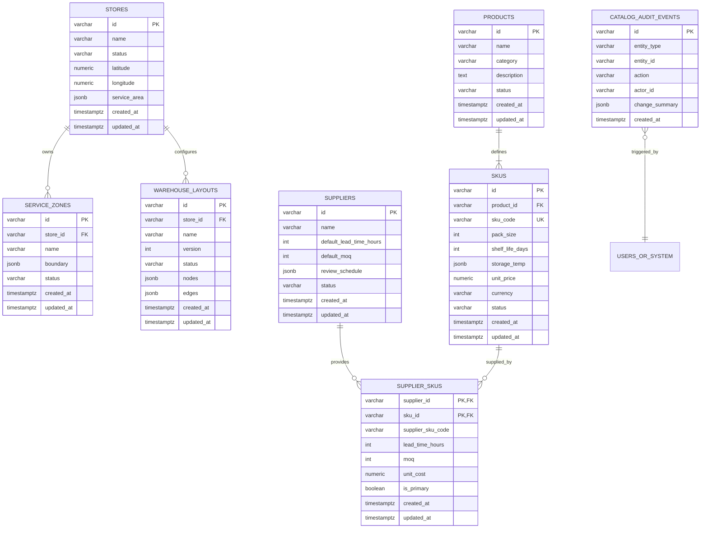

# Catalog Domain Schema & Architecture

This document specifies the catalog domain data models, PostgreSQL persistence schemas, integrity constraints, graph reachability algorithms, and audit invariants implemented in Phase 01 for the DarkOps AI platform.

---

## 1. Entity-Relationship Diagram (ERD)



---

## 2. Table Definitions & Database Constraints

### 2.1 `stores`
- **Primary Key**: `id` (`VARCHAR(64)`).
- **Coordinates**: `latitude` (`NUMERIC(8, 5)` in `[-90, 90]`), `longitude` (`NUMERIC(8, 5)` in `[-180, 180]`).
- **Service Area**: GeoJSON Polygon (`JSONB`) with explicit linear-ring closure enforcement.
- **Statuses**: `ACTIVE`, `INACTIVE`, `MAINTENANCE`.

### 2.2 `service_zones`
- **Ownership**: Explicit 1-to-many relationship (`store_id REFERENCES stores(id) ON DELETE RESTRICT`). Service zones belong to exactly one store to enforce clear dispatch ownership.
- **Geographic Boundary**: Validated GeoJSON Polygon (`JSONB`).

### 2.3 `products` & `skus`
- **Product**: Abstract merchandising entity (`name`, `category`, `description`).
- **SKU**: Physical, transactional unit of trade (`pack_size`, `shelf_life_days`, `storage_temp`, `unit_price`, `currency`).
- **SKU Code**: Enforced unique index across all active/inactive SKUs.
- **Monetary Precision**: Stored as exact `NUMERIC(10, 2)` to eliminate floating-point rounding errors.
- **Storage Temperature**: Structured object specifying unit (`CELSIUS` or `FAHRENHEIT`), min, max, and zone (`AMBIENT`, `CHILLED`, `FROZEN`). Min temperature must be $\le$ max temperature.

### 2.4 `suppliers` & `supplier_skus`
- **Supplier**: Legal entity with default lead times and review schedule (`cadence`, `days_of_week`, `review_time_utc`).
- **Supplier-SKU Association**: Explicit M:N mapping table (`supplier_skus`) allowing SKU-specific lead times, MOQs, unit costs, and `is_primary` designations.

### 2.5 `warehouse_layouts`
- **Versioned Graph**: Stores warehouse topological maps with nodes and movement edges (`JSONB`).
- **Store Relationship**: `store_id REFERENCES stores(id) ON DELETE RESTRICT`.
- **Statuses**: `DRAFT`, `ACTIVE`, `ARCHIVED`. Multiple versions can exist per store; exactly one active layout is active at a time.

### 2.6 `catalog_audit_events`
- **Immutability**: Append-only audit trail recording every catalog mutation.
- **Attributes**: `id`, `entity_type`, `entity_id`, `action` (`CREATE`, `UPDATE`, `DELETE`), `actor_id`, `change_summary`, `created_at`.

---

## 3. Warehouse Layout Graph Validation Algorithm

Prior to persisting or activating any warehouse layout, the layout graph is validated using a multi-source Breadth-First Search (BFS) reachability algorithm.

### Algorithm & Invariants
1. **Node Validation**: Scan all nodes $V$:
   - Ensure node IDs are globally unique within the layout.
   - Collect all `DISPATCH_STATION` node IDs. At least one dispatch station is strictly required.
   - Verify every `SHELF` node specifies non-empty `aisle_id` and `shelf_id`.
2. **Edge Endpoint Verification**: Scan all edges $E$:
   - Verify both `from_node` and `to_node` exist in $V$.
   - Reject invalid or dangling node references.
3. **Adjacency Construction**: Build adjacency list. Support both directed and bidirectional movement paths. Cycles are permitted as warehouses frequently contain loop aisles.
4. **Multi-Source BFS**:
   - Initialize BFS queue with all `DISPATCH_STATION` nodes.
   - Traverse reachable nodes until queue is empty.
5. **Reachability Check**:
   - Assert that every node of type `SHELF` has been visited during BFS traversal.
   - Reject layouts with disconnected or orphaned shelves.

### Algorithmic Complexity
- **Time Complexity**: $\mathcal{O}(|V| + |E|)$ where $|V|$ is the number of warehouse nodes and $|E|$ is the number of edges.
- **Space Complexity**: $\mathcal{O}(|V| + |E|)$ for the adjacency list and visited set.

---

## 4. Audit & Transactional Invariants

1. **Atomic Persistence**:
   - All catalog mutations (create, update, delete) and their corresponding `catalog_audit_events` row are executed within the **same PostgreSQL database transaction** (`withTransaction`).
   - If either the mutation or the audit insert fails, the transaction is rolled back completely. A mutation is never committed without its audit record.
2. **Actor Identification**:
   - Administrative mutations require authorization and extract the actor identity via `X-Actor-Id` or authorized credentials.
   - In production or when `REQUIRE_AUTH=true`, requests lacking administrative tokens return `401 UNAUTHORIZED`.

---

## 5. Migration & Local Database Verification

### Migration Mechanism
The repository uses a transactional SQL migration runner (`src/database/migrate.ts`) tracking applied scripts in `schema_migrations`.

### Execution Commands
```bash
# Run migrations inside the containerized network
docker compose run --rm operational-api npm run migrate

# Run service tests
docker compose run --rm operational-api npm test
```
