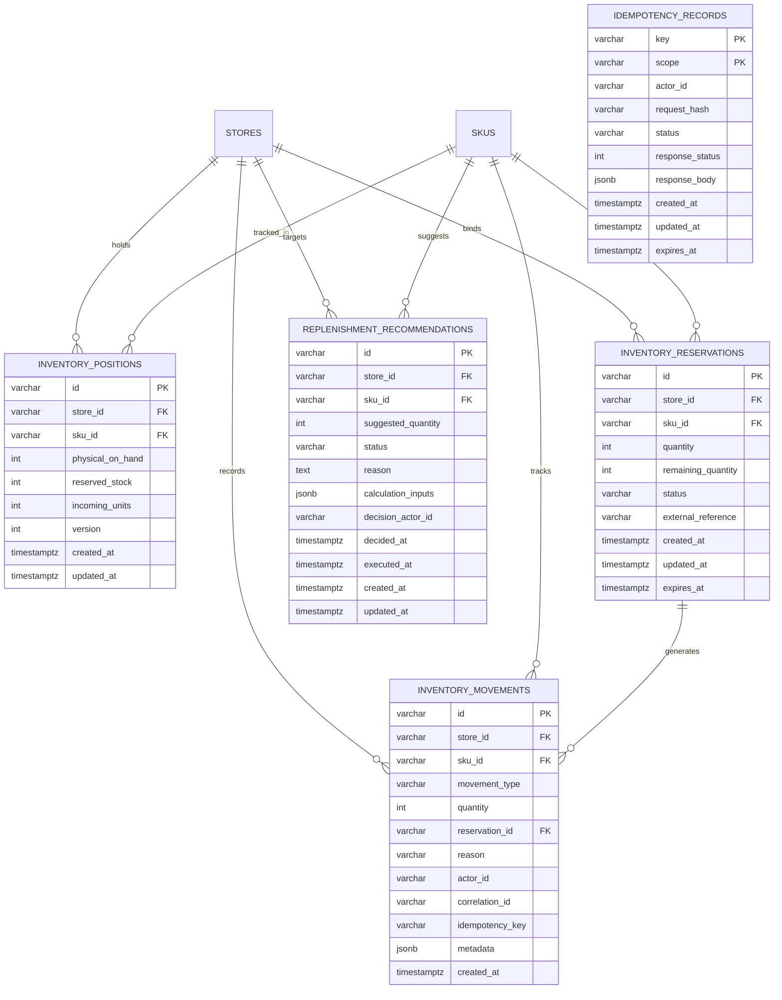
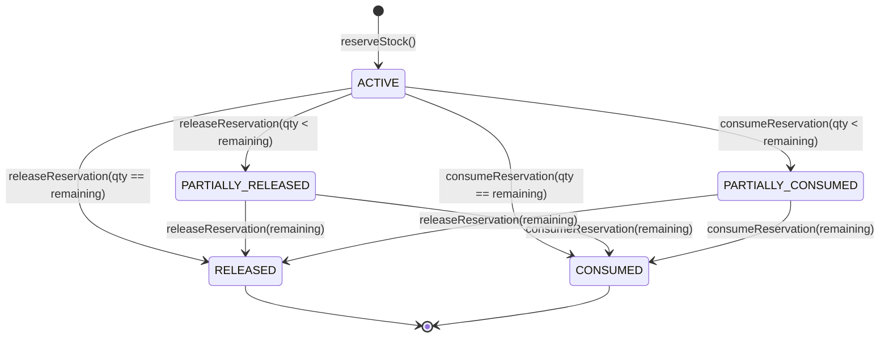

# Inventory Accounting Engine & Immutable Stock Ledger

This document details the architecture, mathematical accounting equations, transactional concurrency controls, durable idempotency, and reconciliation mechanisms implemented in Phase 02 for the DarkOps AI Operational API.

---

## 1. Inventory Accounting Invariants

The inventory domain models discrete stock units across dark stores using a double-entry inspired balance and ledger design.

### Fundamental Accounting Equations

$$\text{Available Stock} = \text{Physical On-Hand} - \text{Reserved Stock}$$

### Strict Domain & Database Invariants

1. **Non-Negativity**:
   $$\text{Physical On-Hand} \ge 0, \quad \text{Reserved Stock} \ge 0, \quad \text{Incoming Units} \ge 0$$
2. **Solvency Guarantee**:
   $$\text{Reserved Stock} \le \text{Physical On-Hand}$$
   $$\text{Available Stock} \ge 0$$
3. **Derived Availability**:
   `available_stock` is strictly derived from $\text{physical} - \text{reserved}$. It is never stored as an independently writable column to prevent state divergence.
4. **Physical Ingress**:
   Inbound stock in `incoming_units` does not become available until a verified `RECEIPT` ledger movement is committed.
5. **Ledger Consistency**:
   Every balance mutation must be accompanied by an atomic insert into the immutable `inventory_movements` ledger table.

---

## 2. Entity-Relationship Model

---

## 3. Stock Movement Semantics

The `inventory_movements` table is an append-only, immutable transaction log. Normal application paths never update or delete movement records.

| Movement Type | Physical On-Hand | Reserved Stock | Incoming Units | Description |
|---|---|---|---|---|
| `OPENING_STOCK` | $+\Delta$ | No change | Explicitly initialized | Initial stock balance seeding |
| `RECEIPT` | $+\Delta$ | No change | $-\Delta$ (if linked) | Supplier goods inbound arrival |
| `POSITIVE_ADJUSTMENT` | $+\Delta$ | No change | No change | Audit count surplus / found inventory |
| `NEGATIVE_ADJUSTMENT` | $-\Delta$ | No change | No change | Spoilage, breakage, audit shrinkage |
| `RESERVATION` | No change | $+\Delta$ | No change | Order cart hold against available stock |
| `RESERVATION_RELEASE`| No change | $-\Delta$ | No change | Customer cart abandonment or cancellation |
| `PICK_CONSUMPTION` | $-\Delta$ | $-\Delta$ | No change | Verified physical picking tote transfer |

---

## 4. Reservation State Machine

- Invariant: `remaining_quantity >= 0` and `remaining_quantity <= quantity`.
- Finality: A reservation with status `RELEASED` or `CONSUMED` cannot be mutated again.

---

## 5. Concurrency Controls & Row-Level Locking

To eliminate race conditions, overselling, and deadlocks under intense parallel load:

1. **Transaction Boundary**: All stock operations run inside a single PostgreSQL transaction (`withTransaction`).
2. **Explicit Row Locks (`SELECT ... FOR UPDATE`)**:
   - `inventoryPositionRepository.findByStoreAndSkuForUpdate(storeId, skuId, client)` locks the unique position row.
   - Any concurrent request attempting to reserve the same SKU at the same store blocks until the active transaction commits or rolls back.
3. **Lock Ordering**:
   - Operations touching both position and reservation always lock the reservation first (`findByIdForUpdate`), followed by the position (`findByStoreAndSkuForUpdate`).
   - When batch reservations touch multiple SKUs, items are sorted alphabetically by `(store_id, sku_id)` before locking to prevent cyclic deadlocks.
4. **Instant Invariant Verification**:
   - After acquiring the lock, available stock is re-evaluated:
     $$\text{available} = \text{position.physical} - \text{position.reserved}$$
   - If $\text{available} < \text{requested}$, the transaction immediately aborts and throws `InsufficientStockError` (HTTP 409).

---

## 6. Durable Idempotency & Conflict Detection

Mutating endpoints enforce an `Idempotency-Key` header with persistent storage in `idempotency_records`:

1. **Deterministic Fingerprint**:
   Request bodies are canonicalized by recursively sorting JSON keys before computing a SHA-256 hash.
2. **Atomic Key Claim**:
   An atomic `INSERT INTO idempotency_records (...) ON CONFLICT (key, scope) DO NOTHING` attempts to claim status `PROCESSING`.
3. **Replay vs. Conflict Behavior**:
   - **Identical Replay**: If the key exists with the exact same fingerprint and status `COMPLETED`, the cached response and HTTP status code are returned immediately without re-executing any business mutations.
   - **Payload Mismatch Conflict**: If the key was previously used with a different request payload, the request is rejected with HTTP 409 `IDEMPOTENCY_KEY_REUSED`.
   - **Concurrent Duplicate**: If a parallel request is currently processing with the same key, it is rejected with HTTP 409 `CONCURRENCY_CONFLICT`.

---

## 7. Ledger Reconciliation Engine

The system provides on-demand verification of stored positions against historical ledger events:

$$\text{Expected Physical} = \sum (\text{OPENING} + \text{RECEIPT} + \text{POS\_ADJ} - \text{NEG\_ADJ} - \text{PICK\_CONSUMPTION})$$
$$\text{Expected Reserved} = \sum (\text{RESERVATION} - \text{RESERVATION\_RELEASE} - \text{PICK\_CONSUMPTION})$$

A position is certified as balanced when:
$$\Delta_{\text{physical}} = \text{physical\_on\_hand} - \text{Expected Physical} = 0$$
$$\Delta_{\text{reserved}} = \text{reserved\_stock} - \text{Expected Reserved} = 0$$

Endpoint: `GET /api/v1/inventory/reconcile/:storeId/:skuId` returns full reconciliation audit data without altering operational tables.

---

## 8. Threshold-Based Replenishment Policy

A deterministic, rule-based recommendation policy computes reorder triggers without introducing forecasting dependencies:

1. **Effective Inventory**:
   $$\text{Effective Stock} = \text{Available Stock} + \text{Incoming Units}$$
2. **Reorder Point**:
   $$\text{ROP} = \lceil \text{Supplier MOQ} \times \text{Safety Stock Factor} \rceil$$
3. **Suggested Quantity**:
   If $\text{Effective Stock} \le \text{ROP}$:
   $$\text{Suggested Quantity} = \max(\text{ROP} \times 2 - \text{Effective Stock}, \text{Supplier MOQ})$$
4. **Lifecycle**:
   `PENDING` $\rightarrow$ `APPROVED` or `REJECTED` $\rightarrow$ `EXECUTED`.

---

## 9. Standardized Error Codes

| Error Code | HTTP Status | Description |
|---|---|---|
| `VALIDATION_ERROR` | 400 | Missing header or malformed Zod request payload |
| `INVALID_RESERVATION_STATE` | 400 | Attempted release or consumption exceeding remaining quantity or on finalized reservation |
| `INVENTORY_POSITION_NOT_FOUND`| 404 | No position initialized for specified store and SKU |
| `RESERVATION_NOT_FOUND` | 404 | Specified reservation ID does not exist |
| `REPLENISHMENT_RECOMMENDATION_NOT_FOUND` | 404 | Specified recommendation ID does not exist |
| `INSUFFICIENT_STOCK` | 409 | Requested reservation or negative adjustment exceeds available stock |
| `CONCURRENCY_CONFLICT` | 409 | Concurrent request with the same idempotency key is in progress |
| `IDEMPOTENCY_KEY_REUSED` | 409 | Idempotency key reused with a conflicting payload |
