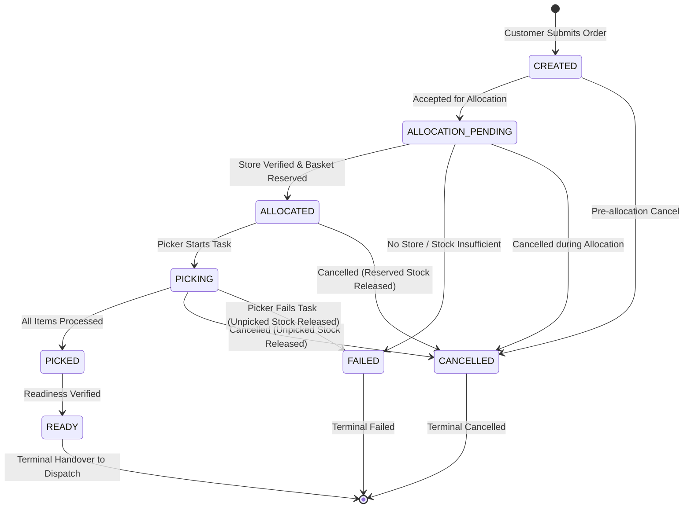
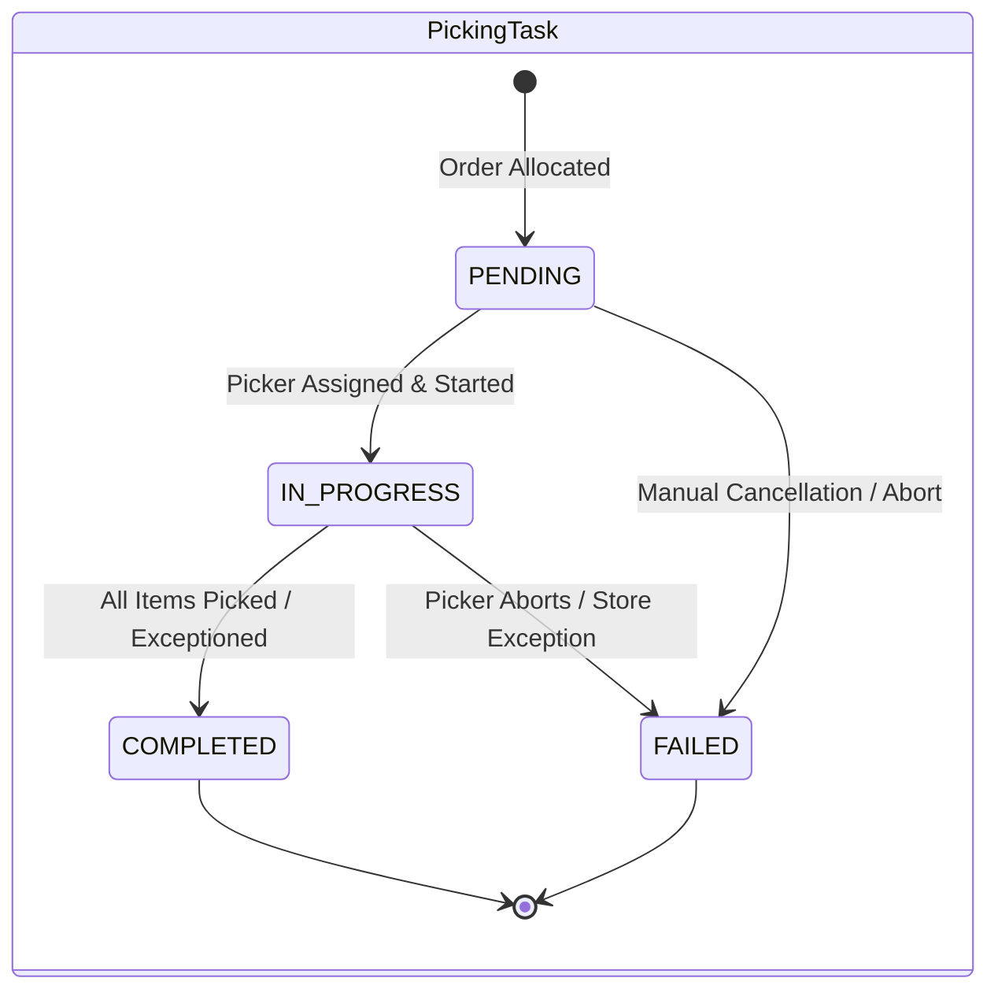
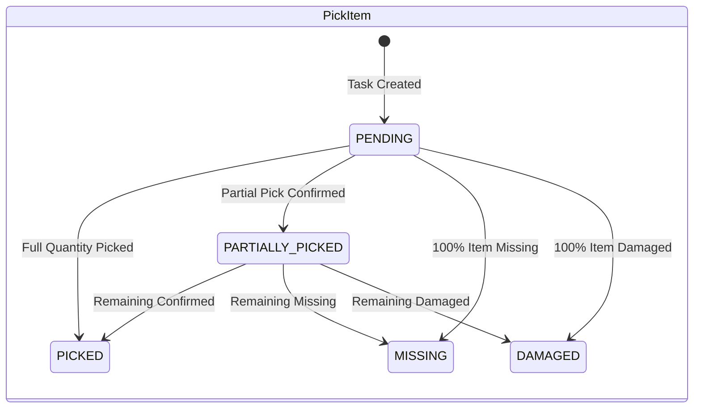

# Order Lifecycle & Picking Architecture

This document specifies the domain state machines, single-store basket allocation workflows, inventory reservation coordination, picking task execution, cancellation semantics, and compensation policies for Phase 03 of DarkOps AI.

---

## 1. State Machines

### 1.1 Order State Transition Graph

#### Order Status Transition Invariants:
1. **No direct status jumps**: Transitions like `CREATED -> ALLOCATED` or `ALLOCATED -> READY` are strictly prohibited and rejected by `OrderStateMachine.validateOrderTransition`.
2. **Post-pick cancellation forbidden**: `PICKED -> CANCELLED` is prohibited in this phase.
3. **Terminal permanence**: `READY`, `CANCELLED`, and `FAILED` are strictly terminal; no transitions out of terminal states are permitted.

---

### 1.2 Picking Task & Pick Item State Machines

---

## 2. Store Eligibility & Single-Store Basket Allocation

Single-store allocation evaluates candidate stores deterministically without splitting orders across stores:

### 2.1 Candidate Filtering Pipeline
1. **Store Status**: Store must have `status = 'ACTIVE'`.
2. **Geographic Coverage**:
   - Customer coordinates `(latitude, longitude)` are tested against:
     - Specific active `service_zones` (`service_zones.status = 'ACTIVE'`).
     - Store general `service_area` polygon.
   - Point-in-polygon evaluation uses the ray-casting algorithm (`domain/polygon.utils.ts`) with inclusive boundary edge testing.
3. **Deterministic Candidate Ordering**:
   - Priority 1: Direct active service-zone match (score = 1) prioritized over general store polygon (score = 2).
   - Priority 2 (Tie-breaker): Store ID lexicographical ascending (`store.id.localeCompare(...)`).

### 2.2 Inventory Reservation Handshake
For each candidate store in priority order:
1. `InventoryService.reserveBasket` is invoked with all requested SKUs.
2. Row-level locks (`SELECT ... FOR UPDATE`) are acquired on all SKUs in **deterministic sorted SKU code order** to eliminate deadlocks.
3. If any SKU has `available_stock < requested_quantity`, `InsufficientStockError` is thrown, rolling back the database transaction automatically without leaving partial reservations.
4. If reservation succeeds:
   - Order is updated to `ALLOCATED` with `store_id` and timestamps.
   - Order lines are linked with `reservation_id` references.
   - Active warehouse layout is queried for the allocated store.
   - Shelf nodes (`type = 'SHELF'`) map physical shelf locations to pick items.
   - Exactly one initial `PickingTask` and its `PickItem` records are created in `PENDING` status.
   - Allocation workflow status transitions to `SUCCEEDED`.

---

## 3. Pick Confirmation & Inventory Consumption

- **Pick Confirmation** (`POST /api/v1/picking/tasks/:taskId/items/:itemId/confirm`):
  - Validates `picked_quantity <= remaining_quantity`.
  - Atomically consumes inventory in Inventory Core (`InventoryService.consumeReservation`):
    $$\Delta \text{physical\_on\_hand} = -\text{picked\_quantity}$$
    $$\Delta \text{reserved\_stock} = -\text{picked\_quantity}$$
    $$\Delta \text{available\_stock} = 0$$
  - Records immutable `PICK_CONSUMPTION` ledger entry.
  - Updates `confirmed_picked_quantity` and status.
  - Automatically completes task and transitions order to `READY` when all items are accounted for.

- **Item Exception Reporting** (`POST /api/v1/picking/tasks/:taskId/items/:itemId/report-exception`):
  - Used when an item is `MISSING` or `DAMAGED`.
  - Releases unfulfilled reserved stock back to available stock in Inventory Core:
    $$\Delta \text{reserved\_stock} = -\text{exception\_quantity}$$
    $$\Delta \text{available\_stock} = +\text{exception\_quantity}$$
  - Records immutable `RESERVATION_RELEASE` ledger entry.
  - Order line records explicit `missing_quantity` or `damaged_quantity`.
  - Order completes with verified partial fulfillment.

---

## 4. Order Cancellation & Failure Compensation

- **Cancellation** (`POST /api/v1/orders/:orderId/cancel`):
  - Permitted for orders in `CREATED`, `ALLOCATION_PENDING`, `ALLOCATED`, and `PICKING`.
  - Prohibited for `PICKED`, `READY`, and `FAILED` orders.
  - For allocated/picking orders:
    - Finds all order lines.
    - Computes unconsumed reserved stock: $\text{unconsumed} = \text{reserved\_quantity} - \text{picked\_quantity}$.
    - Calls `InventoryService.releaseReservation` for unconsumed units.
    - Transitions associated active picking task to `FAILED` with reason `Order cancelled`.
    - Transitions order to `CANCELLED` and logs `ORDER_CANCELLED` lifecycle event.
    - Repeated cancellation calls are idempotent no-ops.

- **Picking Task Failure** (`POST /api/v1/picking/tasks/:taskId/fail`):
  - Releases all remaining unconsumed reserved inventory.
  - Transitions order to `FAILED` with explicit failure code and reason.

---

## 5. Concurrency & Idempotency Guarantees

1. **Idempotency Fingerprinting**:
   - Mutating commands (`POST /api/v1/orders`, `POST /api/v1/orders/:orderId/allocate`, `POST /api/v1/orders/:orderId/cancel`, and picking endpoints) support the `Idempotency-Key` header.
   - Uses durable SHA-256 payload hashing in `idempotency_records`.
   - Repeated requests return the identical cached status and payload.
   - Conflicting payloads with an existing key return `HTTP 409 Conflict`.
2. **Competing Order Concurrency**:
   - When multiple orders compete for remaining stock, row-level locks on `inventory_positions` ensure strictly serial execution.
   - Exactly one order is allocated the remaining inventory; all competing orders fail gracefully with `HTTP 422 Unprocessable Entity` (`ORDER_ALLOCATION_FAILED`).
   - Zero overselling and zero stock balance discrepancies occur.

---

## 6. REST API Endpoints

### Orders
- `POST /api/v1/orders`: Create order with validated lines.
- `GET /api/v1/orders`: Paginated order search.
- `GET /api/v1/orders/:orderId`: Full order details, lines, and lifecycle audit events.
- `POST /api/v1/orders/:orderId/allocate`: Single-store allocation and reservation handshake.
- `POST /api/v1/orders/:orderId/cancel`: Order cancellation with reservation release.

### Picking
- `GET /api/v1/picking/tasks`: Paginated picking task search.
- `GET /api/v1/picking/tasks/:taskId`: Task details with item shelf assignments.
- `POST /api/v1/picking/tasks/:taskId/start`: Assign picker and begin picking.
- `POST /api/v1/picking/tasks/:taskId/items/:itemId/confirm`: Confirm item pick quantity.
- `POST /api/v1/picking/tasks/:taskId/items/:itemId/report-exception`: Report missing/damaged item.
- `POST /api/v1/picking/tasks/:taskId/fail`: Abort picking task with compensation.
