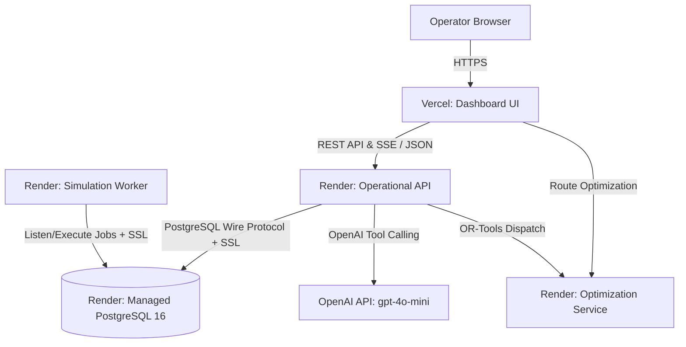

# Production Deployment Guide: Render & Vercel

This guide documents the production deployment architecture and step-by-step instructions for deploying DarkOps AI:
- **Backend**: Hosted on [Render](https://render.com) (Managed PostgreSQL, Node.js Operational API, Python Optimization Service, Python Simulation Worker).
- **Frontend**: Hosted on [Vercel](https://vercel.com) (React + TypeScript + Vite Single-Page Application).

---

## 1. Architecture Topology



---

## 2. Backend Deployment on Render

Render manages container orchestration, SSL certificates, health checks, and database backups automatically. The repository includes a native Infrastructure-as-Code blueprint (`render.yaml`).

### Option A: 1-Click Blueprint Deployment (Recommended)

1. Log in to your [Render Dashboard](https://dashboard.render.com).
2. Click **New +** > **Blueprint**.
3. Connect your GitHub repository containing `DarkOps_AI`.
4. Render detects `render.yaml` and provisions:
   - **`darkops-postgres`**: Managed PostgreSQL 16 database.
   - **`darkops-operational-api`**: Node.js Web Service running `npm run build && npm start` (with `AUTO_MIGRATE=true`).
   - **`darkops-optimization-service`**: Python FastAPI Web Service.
   - **`darkops-simulation-worker`**: Python Background Worker.
5. In the Render Blueprint configuration screen:
   - Enter your `OPENAI_API_KEY` (e.g., `sk-proj-...`).
   - Leave `DATABASE_URL` linked to `darkops-postgres`.
6. Click **Apply**. Render will automatically provision the database, run migrations, and launch all services.

---

### Option B: Manual Service Creation on Render

If configuring services individually:

#### 1. Database: Managed PostgreSQL
- **Service Name**: `darkops-postgres`
- **Database**: `darkops_db`
- **User**: `darkops_user`
- **Region**: Oregon or Frankfurt
- Note the **Internal Database URL** and **External Database URL**.

#### 2. Service 1: Operational API (`services/operational-api`)
- **Type**: Web Service
- **Root Directory**: `services/operational-api`
- **Environment**: Node
- **Build Command**: `npm install && npm run build`
- **Start Command**: `node dist/index.js`
- **Health Check Path**: `/healthz`
- **Environment Variables**:
  - `NODE_ENV`: `production`
  - `AUTO_MIGRATE`: `true`
  - `DATABASE_URL`: *(paste Render Internal Database URL)*
  - `PGSSLMODE`: `require`
  - `CORS_ORIGIN`: `*` (or your Vercel URL `https://your-dashboard.vercel.app`)
  - `JWT_SECRET`: *(generate 32+ character string)*
  - `OPENAI_API_KEY`: *(your OpenAI API key)*
  - `OPENAI_MODEL`: `gpt-4o-mini`

#### 3. Service 2: Optimization Service (`services/optimization-service`)
- **Type**: Web Service
- **Root Directory**: `services/optimization-service`
- **Environment**: Python 3
- **Build Command**: `pip install -r requirements.txt`
- **Start Command**: `uvicorn src.main:app --host 0.0.0.0 --port $PORT`
- **Health Check Path**: `/healthz`
- **Environment Variables**:
  - `PYTHONUNBUFFERED`: `1`

#### 4. Service 3: Simulation Worker (`services/simulation-worker`)
- **Type**: Background Worker
- **Root Directory**: `services/simulation-worker`
- **Environment**: Python 3
- **Build Command**: `pip install -r requirements.txt`
- **Start Command**: `python -m src.main`
- **Environment Variables**:
  - `PYTHONUNBUFFERED`: `1`
  - `DATABASE_URL`: *(paste Render Internal Database URL)*
  - `PGSSLMODE`: `require`

---

## 3. Frontend Deployment on Vercel

The frontend is an optimized Vite Single Page Application configured with `vercel.json` for client-side routing.

### Step-by-Step Vercel Setup

1. Go to [Vercel](https://vercel.com) and click **Add New...** > **Project**.
2. Select your `DarkOps_AI` repository.
3. Configure Project Settings:
   - **Framework Preset**: `Vite`
   - **Root Directory**: `apps/dashboard` (click Edit and select `apps/dashboard`)
   - **Build Command**: `npm run build`
   - **Output Directory**: `dist`
   - **Install Command**: `npm install`
4. Configure **Environment Variables**:
   - `VITE_API_BASE_URL`: `https://darkops-operational-api.onrender.com` (your Render Operational API URL)
   - `VITE_OPTIMIZATION_API_BASE_URL`: `https://darkops-optimization-service.onrender.com` (your Render Optimization Service URL)
   - `VITE_API_AUTH_TOKEN`: *(matches JWT_SECRET or operator token)*
5. Click **Deploy**.
6. Once deployed, copy your production Vercel URL (e.g., `https://darkops-ai.vercel.app`) and optionally set it as the `CORS_ORIGIN` in Render `darkops-operational-api`.

---

## 4. Post-Deployment Seeding & Verification

Once both Render and Vercel are running:

1. **Verify Backend Health**:
   ```bash
   curl -s https://darkops-operational-api.onrender.com/healthz
   curl -s https://darkops-operational-api.onrender.com/readyz
   curl -s https://darkops-optimization-service.onrender.com/healthz
   ```
2. **Seed Initial 5-Store Demo Data**:
   From your local terminal, run the automated seeding script against your live Render backend:
   ```bash
   # Linux/macOS:
   ./scripts/seed-demo.sh https://darkops-operational-api.onrender.com

   # Windows PowerShell:
   .\scripts\seed-demo.ps1 -ApiUrl "https://darkops-operational-api.onrender.com"
   ```
3. **Open Vercel Dashboard**:
   Navigate to your Vercel URL (`https://your-dashboard.vercel.app`).
   - Confirm active stores render on the Map.
   - Verify inventory balances and stockout risks.
   - Open AI Copilot drawer and execute an authoritative query.

---

## 5. Troubleshooting & FAQ

### Build Failure: `maturin / cargo metadata failed: pydantic-core`
- **Root Cause**: Render's default native environment without explicit version pins may default to Python 3.14 (unreleased/experimental). Modern packages (`pydantic-core`, `ortools`, `psycopg2`) do not have pre-compiled binary wheels on PyPI for Python 3.14, causing pip to attempt building from source with Rust/Cargo, which fails.
- **Solution**:
  1. DarkOps AI pins `PYTHON_VERSION: 3.11.9` in `render.yaml`.
  2. The repository includes `.python-version` containing `3.11.9` in the repository root and service directories.
  3. Pre-compiled Linux wheels for Python 3.11 install immediately without compiling.
  4. If manually configuring on Render, add an environment variable `PYTHON_VERSION=3.11.9` under the service's **Environment** tab.
