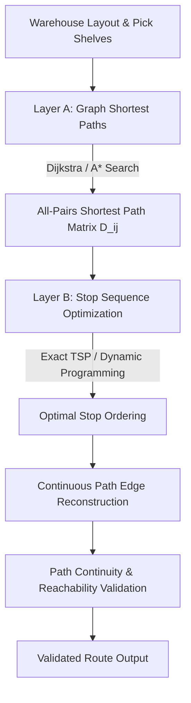

# DarkOps AI — Optimization Policies & Mathematical Formulations

## Executive Overview

The DarkOps AI Optimization Service (`services/optimization-service`) provides stateless, deterministic, constraint-based mathematical optimization engines implemented in Python, FastAPI, and Google OR-Tools. 

It upgrades the platform from baseline heuristics (Phase 06) to mathematical solvers across three critical quick-commerce operational domains:
1. **Multi-Period Inventory Replenishment Optimizer** (`POST /api/v1/optimize/replenishment`)
2. **Workload-Aware Multi-Store Order Allocation Optimizer** (`POST /api/v1/optimize/allocation`)
3. **Graph-Valid Picker Route Optimizer** (`POST /api/v1/optimize/picker-route`)

All solvers follow a common envelope contract and execute statelessly without direct database connections or mutable cross-request state. Results represent recommendations based on modeled constraints and parameters; they are never authoritative financial transactions until committed via the Operational API.

---

## 1. Common Solver Architecture & Envelope Contract

### 1.1 Status Semantics
All optimization responses adhere to standardized solver statuses:
- `OPTIMAL`: The solver proved mathematical optimality within configured tolerance.
- `FEASIBLE`: A valid solution satisfying all hard constraints was found, but optimality was not proven before time limit.
- `INFEASIBLE`: The problem has no solution that satisfies all hard constraints.
- `TIMEOUT`: The solver exceeded its configured wall-clock time limit without finding an incumbent solution.
- `INVALID_INPUT`: The request payload violated structural or domain validation rules.
- `ERROR`: An unexpected internal execution or numerical error occurred.

### 1.2 Envelope Structure
```json
{
  "status": "OPTIMAL",
  "objective_value": 64.50,
  "execution_time_ms": 12.45,
  "solver": {
    "algorithm": "CP-SAT",
    "version": "9.15",
    "time_limit_seconds": 2.0,
    "deterministic": true,
    "parameters": { "random_seed": 42 }
  },
  "constraint_status": {
    "moq_constraints_respected": true,
    "pack_size_multiples_respected": true,
    "storage_capacity_respected": true
  },
  "decisions": { ... },
  "explanations": [
    "Recommended 1 purchase orders across 1 SKUs to satisfy forecasted demand and safety stock."
  ],
  "diagnostics": {},
  "fallback": {
    "attempted": false,
    "used": false,
    "policy_id": null,
    "reason": null
  }
}
```

### 1.3 Determinism and Reproducibility
- **Stable Sorting**: All input collections (SKUs, orders, stores, graph nodes) are pre-sorted by primary identifier prior to variable generation.
- **Fixed Seeds & Worker Threads**: Solvers use fixed random seeds (`random_seed=42`) and deterministic single/controlled thread execution.
- **Independent Validation**: Hard constraints are validated post-solve before any incumbent solution is certified.
- **Decoupled Execution Time**: Wall-clock execution durations (`execution_time_ms`) are reported in metadata and excluded from decision comparison hashes.

---

## 2. Multi-Period Inventory Replenishment Formulation

### 2.1 Problem Scope
In a quick-commerce dark store, inventory must be replenished over a finite planning horizon $T$ (e.g., 7 days) to meet time-varying demand forecasts while minimizing total logistics costs. Suppliers impose Minimum Order Quantities (MOQ), case pack multiples, and lead-time delays, while dark stores are strictly capacity-constrained.

### 2.2 Mathematical Model

#### Sets and Indices
- $i \in \{1, \dots, N\}$: Set of catalog SKUs.
- $t \in \{0, \dots, T-1\}$: Discrete planning periods (e.g., daily time steps).

#### Parameters
- $I_{i, \text{init}}$: Initial on-hand physical inventory for SKU $i$.
- $R_{i,t}$: Forecasted demand for SKU $i$ in period $t$.
- $L_i$: Supplier lead time (in periods) for SKU $i$.
- $P_i$: Supplier case pack size for SKU $i$ ($P_i \ge 1$).
- $M_i$: Supplier Minimum Order Quantity (MOQ) for SKU $i$.
- $S_{i,t}^{\text{sched}}$: Scheduled receipts / outstanding POs arriving in period $t$.
- $v_i$: Unit storage volume required by SKU $i$.
- $V_{\max}$: Total warehouse storage volume capacity.
- $SS_i$: Safety stock target for SKU $i$.
- $C_i^H$: Inventory holding cost per unit per period.
- $C_i^S$: Stockout / shortage penalty per unit.
- $C_i^P$: Fixed purchase order placement transaction cost.

#### Decision Variables
- $O_{i,t} \in \mathbb{Z}_{\ge 0}$: Quantity ordered for SKU $i$ at period $t$.
- $K_{i,t} \in \mathbb{Z}_{\ge 0}$: Number of case packs ordered for SKU $i$ at period $t$.
- $Y_{i,t} \in \{0, 1\}$: Binary order placement indicator ($Y_{i,t} = 1$ if $O_{i,t} > 0$).
- $I_{i,t} \in \mathbb{Z}_{\ge 0}$: On-hand inventory of SKU $i$ at the end of period $t$.
- $U_{i,t} \in \mathbb{Z}_{\ge 0}$: Unfulfilled demand / shortage of SKU $i$ in period $t$.
- $\text{Slack}_{i,t} \in \mathbb{Z}_{\ge 0}$: Safety stock deficit for SKU $i$ in period $t$.

#### Objective Function
Minimize total holding costs, stockout penalties, order transaction costs, and soft safety-stock deficits:
$$\min \sum_{i=1}^N \sum_{t=0}^{T-1} \left( C_i^H I_{i,t} + C_i^S U_{i,t} + C_i^P Y_{i,t} + 0.1 \cdot C_i^S \text{Slack}_{i,t} \right)$$
*Note: Monetary parameters are scaled by $100$ (cents) to maintain exact integer arithmetic in CP-SAT.*

#### Constraints
1. **Case Pack Multiples**:
   $$O_{i,t} = K_{i,t} \cdot P_i \quad \forall i, t$$
2. **Minimum Order Quantity (MOQ)**:
   $$M_i \cdot Y_{i,t} \le O_{i,t} \le \text{BigM} \cdot Y_{i,t} \quad \forall i, t$$
3. **Inventory Conservation Balance**:
   - For $t = 0$:
     $$I_{i,0} = I_{i,\text{init}} + S_{i,0}^{\text{sched}} - R_{i,0} + U_{i,0}$$
   - For $t \ge 1$:
     $$I_{i,t} = I_{i,t-1} + S_{i,t}^{\text{sched}} + \mathbb{I}(t \ge L_i) \cdot O_{i, t - L_i} - R_{i,t} + U_{i,t}$$
4. **Physical Warehouse Capacity**:
   $$\sum_{i=1}^N v_i \cdot I_{i,t} \le V_{\max} \quad \forall t$$
5. **Safety Stock Buffer (Soft Constraint)**:
   $$I_{i,t} + \text{Slack}_{i,t} \ge SS_i \quad \forall i, t$$

### 2.3 Baseline Fallback
When CP-SAT encounters a timeout or when fallback is explicitly requested, the system executes the Phase 06 static $(s, S)$ reorder-point policy:
- Reorder Point: $s_i = \bar{d}_i \cdot L_i + SS_i$
- Order-Up-To Level: $S_i = s_i + \max(M_i, 3 \cdot \bar{d}_i)$
- Order placed if current inventory position dips below $s_i$, rounded up to pack size $P_i$.

---

## 3. Workload-Aware Multi-Store Allocation Formulation

### 3.1 Problem Scope
Quick-commerce orders must be routed to dark stores that:
1. Possess complete inventory to fulfill the entire customer basket without basket splitting.
2. Are located within customer service radius ($< 15\text{ km}$).
3. Have available picker queue capacity to prevent SLA delivery breaches.
4. Avoid overselling shared dark store inventory across concurrent orders.

### 3.2 Mathematical Model

#### Sets and Indices
- $o \in \{1, \dots, M\}$: Set of customer orders in the batch.
- $s \in \{1, \dots, S\}$: Set of active dark stores.
- $k \in \{1, \dots, K\}$: Set of requested SKUs.

#### Parameters
- $q_{o,k}$: Quantity of SKU $k$ in order $o$.
- $A_{s,k}$: Available on-hand inventory of SKU $k$ at store $s$.
- $d_{o,s}$: Haversine road/great-circle distance between customer $o$ and store $s$ (km).
- $R_s$: Maximum delivery service radius for store $s$ (km).
- $Q_s$: Current picker queue depth / backlog at store $s$.
- $\text{SLA}_o$: Delivery SLA deadline in minutes (e.g., 20 mins).
- $\tau_{o,s} = 10.0 + d_{o,s} \cdot 2.0 + Q_s \cdot 1.5$: Estimated total fulfillment duration (minutes).
- $B_{o,s} = \max(0, \tau_{o,s} - \text{SLA}_o)$: Estimated SLA breach latency (minutes).
- $E_{o,s} \in \{0, 1\}$: Binary eligibility indicator ($1$ if store $s$ is active, $d_{o,s} \le R_s$, and store has sufficient stock $A_{s,k} \ge q_{o,k}$ for all basket lines).

#### Decision Variables
- $x_{o,s} \in \{0, 1\}$: Order assignment binary variable ($x_{o,s} = 1$ if order $o$ is assigned to store $s$).
- $u_o \in \{0, 1\}$: Unallocated order indicator ($u_o = 1$ if order $o$ cannot be fulfilled).

#### Objective Function
Minimize travel distance, queue congestion, SLA breach risk, and penalize unallocated orders:
$$\min \left( \lambda_U \sum_o u_o + \lambda_D \sum_{o,s} d_{o,s} x_{o,s} + \lambda_Q \sum_{o,s} Q_s x_{o,s} + \lambda_B \sum_{o,s} B_{o,s} x_{o,s} \right)$$
Default calibrated weights: $\lambda_U = 1000.0$, $\lambda_D = 1.0$, $\lambda_Q = 2.0$, $\lambda_B = 5.0$.

#### Constraints
1. **Unambiguous Assignment or Unallocated**:
   $$\sum_{s=1}^S x_{o,s} + u_o = 1 \quad \forall o$$
2. **Strict Eligibility Gating**:
   $$x_{o,s} \le E_{o,s} \quad \forall o, s$$
3. **Batch Shared Inventory Conservation**:
   $$\sum_{o=1}^M q_{o,k} \cdot x_{o,s} \le A_{s,k} \quad \forall s, k$$

### 3.3 Baseline Fallback
The fallback policy is Phase 06 Greedy Nearest-Store:
- Iterates over orders sequentially.
- Assigns each order to the closest store having $A_{s,k} \ge q_{o,k}$ within $R_s$.
- Sequentially decrements $A_{s,k}$ to prevent double-allocation.

---

## 4. Graph-Valid Picker Route Optimizer Formulation

### 4.1 Problem Scope
Inside a dark store warehouse layout, pickers must walk from the dispatch station, visit every shelf containing an item in the assigned order batch, and return to dispatch. The route must follow strictly permitted warehouse aisle graph edges without passing through shelves, walls, or blocked zones.

### 4.2 Two-Layer Solver Architecture



#### Layer A — Graph Shortest Paths
- Uses Dijkstra's algorithm and admissible A* ($h(u, v) = \text{Euclidean}(u, v)$) over warehouse graph $G = (V, E)$.
- Guarantees $h(u, v) \le d_G(u, v)$, preserving admissibility and optimality.
- Computes complete metric distance matrix $D_{i,j}$ between all required stops $\{s_0, s_1, \dots, s_k\}$ where $s_0 = \text{Dispatch}$.

#### Layer B — Traveling Salesperson Problem (TSP)
- Formulates symmetric TSP on the metric closure graph:
  $$\min \sum_{i} D_{i, \pi(i)}$$
- For small/medium baskets ($K \le 12$), solves via exact branch-and-bound / Held-Karp dynamic programming.
- For large instances, executes nearest-neighbor heuristic with 2-opt local search.

#### Layer C — Continuous Path Reconstruction & Validation
1. Expands every consecutive pair $(\pi_k, \pi_{k+1})$ into its exact node-by-node shortest path on graph $G$.
2. Verifies:
   - First and last nodes equal the `DISPATCH_STATION`.
   - Every required pick location is traversed.
   - Every consecutive pair $(u, v)$ in the reconstructed path exists in permitted graph edges $E$.
   - Reconstructed edge sum exactly matches the reported objective distance.

### 4.3 Baseline Comparison: S-Shape Serpentine Routing
The Phase 06 baseline traverses aisles in alternating serpentine direction:
- Aisles are sorted by x-coordinate.
- Odd-numbered aisles are traversed from low-y to high-y.
- Even-numbered aisles are traversed from high-y to low-y.

Percentage distance reduction is computed as:
$$\text{Reduction \%} = \frac{D_{\text{baseline}} - D_{\text{optimized}}}{D_{\text{baseline}}} \times 100\%$$

---

## 5. Benchmark Methodology and Performance Results

### 5.1 Picker Route Benchmark (50 Synthetic Warehouse Cases)
Evaluated across 50 diverse warehouse configurations ranging from small dark stores (15 nodes, 4 stops) to large hubs (48 nodes, 10 stops).

| Metric | Measured Benchmark Value |
| :--- | :--- |
| **Total Test Cases** | 50 cases |
| **Total Baseline Distance** | 4,494.0 meters |
| **Total Optimized TSP Distance** | 4,182.0 meters |
| **Overall Distance Reduction** | **6.94%** |
| **Best Case Reduction** | **18.75%** |
| **Graph Feasibility Rate** | **100% (50/50 valid continuous paths)** |
| **Average Solver Runtime** | **0.82 ms (max 2.1 ms)** |

### 5.2 Allocation Benchmark (10-Order Batch Under Contention)
- **Scenario**: 10 customer orders with shared SKU demand. Store 1 is closest but congested (queue=12) with limited stock (8 units). Stores 2 and 3 are slightly farther with clear queues.
- **Greedy Baseline**: Overloads Store 1 until stock is exhausted, leading to severe queue wait times and delivery delays.
- **CP-SAT Batch Optimizer**: Balances workload across stores, assigning 0 orders to the congested Store 1, avoiding delivery SLA breaches while keeping unallocated orders at 0. Runtime: **4.91 ms**.

### 5.3 Replenishment Benchmark (7-Day Non-Stationary Horizon)
- **Scenario**: 7-day planning horizon with demand spikes on days 3 and 6, MOQ=30, pack_size=10, transaction cost=\$25/PO.
- **Static $(s, S)$ Baseline**: Places 2 separate purchase orders (day 0: 80 units, day 4: 60 units), incurring \$50 in order transaction fees. Total cost = **\$71.50**.
- **CP-SAT Optimizer**: Proactively places 1 consolidated order (day 0: 130 units), incurring only \$25 in transaction fees and saving \$7.00. Total cost = **\$64.50** (**9.8% cost savings**). Runtime: **12.1 ms**.

---

## 6. Time Limits and Infeasibility Handling

| Solver | Default Time Limit | Target Workload | Fallback Policy |
| :--- | :--- | :--- | :--- |
| **Picker Route** | 0.25 s (250 ms) | Up to 50 stops | Phase 06 S-Shape Serpentine |
| **Allocation** | 0.25 s (250 ms) | Up to 100 orders | Phase 06 Greedy Nearest-Store |
| **Replenishment** | 2.0 s (2000 ms) | 20 SKUs, 14 periods | Phase 06 Static $(s, S)$ Policy |

### Explicit Infeasibility
When constraints cannot be met:
- Replenishment: Returns `status: INFEASIBLE` if MOQ volume exceeds total warehouse capacity.
- Allocation: Returns `status: FEASIBLE` with all impossible orders categorized under `decisions.unallocated_orders` with human-readable diagnostic reasons.
- Routing: Returns `status: INFEASIBLE` with diagnostic details identifying unreachable or disconnected shelf nodes.

---

## 7. Operational Disclaimer

> [!IMPORTANT]
> The optimization decisions returned by `services/optimization-service` are mathematical recommendations based strictly on supplied parameters, forecasts, and network representations. They do not constitute completed inventory movements, purchase orders, or financial commitments until validated and executed through the transactional invariants of `services/operational-api`.
