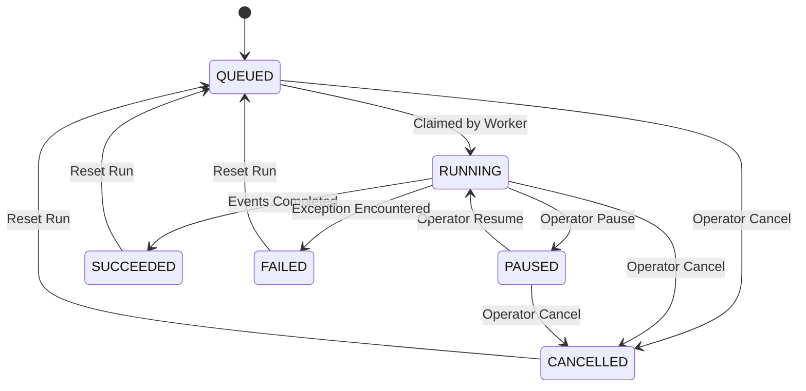

# DarkOps AI — Simulation Lab & Policy Optimization Guide

## 1. Purpose of the Simulation Lab

The **Simulation Lab** is DarkOps AI's decision-support workspace for quick-commerce operators. It connects operators directly to the discrete-event simulation engine (`services/simulation-worker`), Operational API (`services/operational-api`), optimization solvers (`services/optimization-service`), and the event-derived evaluation service.

Key capabilities:
- **Scenario Studio**: Configure synthetic dark store network environments with configurable horizons, demand arrival rates, surge multipliers, lead times, and deterministic random seeds.
- **Run Lifecycle Execution Console**: Observe virtual simulation time, dispatch lifecycle commands (`pause`, `resume`, `cancel`, `reset`), and track live queue backlog metrics.
- **Event Stream Timeline**: Inspect canonically ordered discrete events persisted to PostgreSQL with type filtering and full JSON payload introspection.
- **A/B Policy Evaluation Lab**: Compare baseline heuristics against OR-Tools optimized policies side by side with rigorous fair-comparison guardrails and verifiable KPI deltas.
- **Reproducible Report Generator**: Export machine-readable JSON artifacts and executive Markdown reports containing full scenario metadata, KPI status tags, and event completeness indicators.

---

## 2. How to Configure a Scenario

1. Navigate to `/simulations` in the DarkOps AI dashboard.
2. Under the **Configuration Studio** tab, select a scenario template:
   - **Manhattan Urban Network (`manhattan-demo`)**: 2 dark stores, 16 fast-moving grocery SKUs, multi-aisle layout.
   - **Small Fast Benchmark (`fast-01`)**: 1 store, 4 SKUs, quick benchmark run.
3. Configure the experiment parameters:
   - **Duration**: Target simulation duration in hours (default: `12.0` hours).
   - **Random Seed**: Integer seed controlling pseudo-random number generator (PRNG) streams (default demonstration seed: `101`).
   - **Evaluation Mode**:
     - `Baseline`: Dispatches a single run executing heuristic policies (`baseline_policies_v1`).
     - `Optimized`: Dispatches a single run executing OR-Tools optimization solvers (`optimized_policies_v1`).
     - `Paired A/B`: Dispatches both runs concurrently with identical seeds and scenario parameters for strict side-by-side comparison.
   - **Arrival Rate Multiplier**: Factor modulating baseline customer order arrival intensity $\lambda(t)$.
   - **Surge Multiplier**: Demand peak amplification factor (1.0x to 5.0x).
   - **Supplier Lead Time**: Minimum and maximum delivery window bounds (hours).
4. Review the **Authoritative Experiment Submission Summary** banner at the bottom of the form.
5. Click **Launch Simulation** to submit the job to the Operational API.

---

## 3. Supported Scenario Parameters and Policy Options

| Parameter | Type / Unit | Default | Supported Range | Description |
|---|---|---|---|---|
| `scenario_id` | String | `manhattan-demo` | Registered templates | Identifies the synthetic world snapshot |
| `duration_hours` | Float (hours) | `12.0` | `0.1` to `168.0` | Total virtual simulation horizon |
| `seed` | BigInt | `101` | `0` to $2^{31}-1$ | Primary deterministic PRNG seed |
| `demand_rate_multiplier` | Float | `1.0` | `0.1` to `10.0` | Scales Poisson arrival intensity |
| `surge_multiplier` | Float | `1.0` | `0.1` to `5.0` | Peak-hour demand surge multiplier |
| `supplier_lead_time_min_hours` | Integer | `12` | $\ge 1$ | Minimum supplier fulfillment lag |
| `supplier_lead_time_max_hours` | Integer | `48` | $\ge \text{min}, \le 336$ | Maximum supplier fulfillment lag |
| `policy_identifier` | String | `baseline_policies_v1` | Policy identifiers | Target heuristic or solver package |

---

## 4. How to Submit, Pause, Resume, Cancel, and Reset Runs

All lifecycle transitions strictly adhere to the state machine defined in `services/simulation-worker/src/simulation/jobs.py` and enforced by `services/operational-api/src/services/simulation.service.ts`:



- **Submit**: Submitting via `POST /api/v1/simulation/runs` places the job in `QUEUED` state.
- **Pause**: Enabled only when status is `RUNNING` via `POST /api/v1/simulation/runs/:id/pause`. Halts event loop processing at the next safe virtual boundary.
- **Resume**: Enabled only when status is `PAUSED` via `POST /api/v1/simulation/runs/:id/resume`. Re-enables the event loop.
- **Cancel**: Available during `QUEUED`, `RUNNING`, or `PAUSED` via `POST /api/v1/simulation/runs/:id/cancel`. Permanently stops processing and marks the run `CANCELLED`.
- **Reset**: Available only for terminal runs (`SUCCEEDED`, `FAILED`, `CANCELLED`) via `POST /api/v1/simulation/runs/:id/reset`. Requires operator confirmation. Cleanly deletes run-scoped `simulation_events` and `simulation_evaluations`, and restores the run record to `QUEUED` without touching shared store catalogs or other simulation experiments.

---

## 5. Virtual Time and Execution Speed

- **Authoritative Virtual Clock**: DarkOps AI simulations operate strictly on virtual simulation timestamps (`current_virtual_time`). The virtual clock advances solely when an event is popped from the priority queue.
- **Zero Wall-Clock Sleeps**: The simulation engine never sleeps or blocks on real-world wall clock timers. 12 virtual simulation hours are processed in seconds of compute time.
- **Execution Rate vs Playback Rate**: In the UI, speed options (`1x`, `10x`, `50x`, `Max`) denote visual event animation/playback throttle rates. They do not alter backend mathematical execution speed.
- **Interpolation Invariant**: When an active run is polled, the display indicates virtual progress. Interpolation is frozen immediately when a run transitions to `PAUSED`, `SUCCEEDED`, `FAILED`, or `CANCELLED`.

---

## 6. How Event Polling and Timeline Ordering Work

1. **Canonical Event Ordering**: Events are ordered strictly by:
   $$\text{ORDER BY } \text{virtual\_timestamp ASC}, \text{priority ASC}, \text{sequence\_number ASC}$$
   Events are never reordered based on browser network arrival time.
2. **Bounded Polling**:
   - When a run is `RUNNING`, the UI polls `GET /api/v1/simulation/runs/:id/events` every 2,000ms.
   - When a run reaches a terminal state (`SUCCEEDED`, `FAILED`, `CANCELLED`), polling ceases immediately to prevent redundant network traffic.
3. **Sequence Cursors**: The API supports `after_sequence_number` pagination to retrieve only newly committed events.
4. **Filtering & Inspection**: Operators can filter by event type (e.g., `CUSTOMER_ORDER_ARRIVED`, `ORDER_ALLOCATED`, `STOCK_RESERVED`, `PICKING_STARTED`, `PICKING_COMPLETED`, `SUPPLIER_DELIVERY_DUE`, `STOCK_RECEIVED`) and search payload text for specific order or store identifiers.

---

## 7. How to Compare Baseline and Optimized Policies

1. Open the **A/B Policy Evaluation** tab (`/simulations?tab=compare`).
2. Select the **Baseline Run** (reference heuristic) from the dropdown.
3. Select the **Candidate Run** (OR-Tools optimized policy) from the dropdown.
4. Click **Evaluate A/B Policy Impact** to invoke `POST /api/v1/evaluation/compare`.
5. The backend validates experimental conditions, computes exact metric differences, classifies improvement directionality, and returns the authoritative comparison payload.

---

## 8. Fair-Comparison Rules and Reproducibility Limitations

A comparison between two simulation runs is considered **fair** only when:
- **Identical Scenario**: Both runs use the exact same `scenario_id` and catalog snapshot.
- **Identical Random Seed**: Both runs execute with the exact same numerical seed (e.g., `101`) to ensure identical exogenous customer order arrivals and basket compositions.
- **Identical Horizon**: The simulated duration ($T_{\text{end}} - T_{\text{start}}$) must match within 5%.
- **Compatible Economic Config**: Carrying cost, stockout penalties, and currency must match.
- **Completed Execution**: Both runs must have reached `SUCCEEDED` status.

If any invariant fails, the UI renders an explicit **Experimental Incompatibilities Detected** warning and withholds the overall performance-improvement claim.

---

## 9. KPI Definitions and Metric-Status Handling

All metrics originate from the canonical Phase 07 formulas implemented in `services/operational-api/src/services/kpi-evaluator.service.ts` and `services/simulation-worker/src/evaluation/formulas.py`:

| KPI Code | Canonical Name | Unit | Objective | Formula Reference |
|---|---|---|---|---|
| `order_fill_rate` | Order Fill Rate | % | `HIGHER_IS_BETTER` | $\frac{\text{Fully Fulfilled Orders}}{\text{Eligible Terminal Orders}} \times 100$ |
| `stockout_rate` | Stockout Rate | % | `LOWER_IS_BETTER` | $\frac{\text{Orders with Allocation Stockout}}{\text{Total Customer Orders}} \times 100$ |
| `total_picker_travel_distance_meters` | Total Picker Distance | meters | `LOWER_IS_BETTER` | Sum of valid layout graph edge traversal distances |
| `turnaround_time_seconds` | Mean Turnaround Time | seconds | `LOWER_IS_BETTER` | Time from order arrival to picking completion |
| `total_cost` | Total Operating Cost | USD | `LOWER_IS_BETTER` | Holding cost + Stockout penalties + PO costs + Waste |
| `peak_queue_depth` | Peak Queue Depth | orders | `LOWER_IS_BETTER` | Maximum orders simultaneously in allocation queue |
| `backlog_order_hours` | Backlog Order-Hours | order-hours | `LOWER_IS_BETTER` | Integral of allocation queue depth over simulated time |

### Metric Statuses:
- `AVAILABLE`: Real recorded events allowed exact formula evaluation.
- `ZERO`: Validly observed metric evaluated to 0.0 (e.g., zero stockouts).
- `NOT_APPLICABLE`: Necessary event types not present in scenario (e.g., perishable spoilage).
- `INSUFFICIENT_DATA`: Missing sample points prevent statistical certainty.
- `INVALID_EVENT_STREAM`: Missing required start/completion pairs in recorded stream.

---

## 10. How to Export JSON and Markdown Reports

1. From the execution console or run history archive, click **Export Report**.
2. An interactive dialog renders the run metadata, event log completeness notice, and preview.
3. Click **Download JSON** for machine-readable JSON artifact export.
4. Click **Download Markdown** for formatted executive Markdown summary export.

---

## 11. Report Schema and Event-Log Completeness

Both report formats include explicit completeness metadata:
- If all events recorded for the run are retrieved, the artifact is tagged `COMPLETE`.
- If a paginated subset is present, the artifact is explicitly tagged `PAGINATED_PARTIAL` to prevent claims of authoritative reproducibility from partial data.

Every exported report artifact includes the exact non-negotiable platform disclaimer:
> **"Simulated results from synthetic quick-commerce environment. Not verified real-world outcomes."**

---

## 12. Local Setup and Required Environment Configuration

Ensure PostgreSQL is running and migrations have been applied:
```bash
# Apply database migrations
cd services/operational-api
npm run migrate
```

Start the backend and dashboard services:
```bash
# Terminal 1: Operational API
cd services/operational-api
npm run dev

# Terminal 2: Optimization Service
cd services/optimization-service
uvicorn src.main:app --port 8000 --reload

# Terminal 3: Simulation Worker
cd services/simulation-worker
python src/main.py

# Terminal 4: Operations Dashboard
cd apps/dashboard
npm run dev
```

---

## 13. Test Commands

Verify tests across all relevant workspaces:

```bash
# Operational API Unit and Contract Tests (87 tests)
cd services/operational-api
npm run test:unit
npm run type-check

# Dashboard Unit and Component Tests (36 tests)
cd apps/dashboard
npm test
npm run type-check
npm run build

# Simulation Worker Tests (43 tests)
cd services/simulation-worker
python -m pytest tests/ -v
```

---

## 14. Known Limitations and Missing Backend Capabilities

1. **Synchronous Speed Throttling**: The simulation engine processes discrete events as fast as compute allows. UI speed buttons control client-side event timeline playback throttling, not virtual engine clock throttling.
2. **Real-Time WebSockets**: Bounded polling (2s interval) is utilized for event stream retrieval. Native streaming WebSockets/SSE is not currently configured on the Operational API.
3. **Multi-Store Route Solver**: The picker routing solver operates on a single warehouse graph layout per picking task. Multi-warehouse consolidated route graphs require partitioning into independent task routes.
